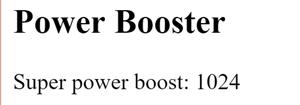
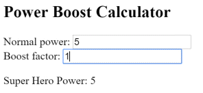
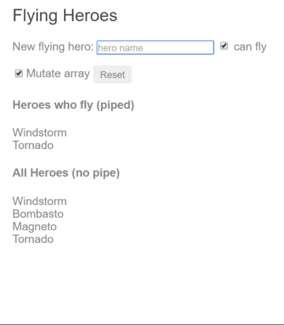
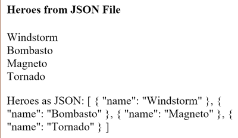

# Pipes

Pipes transform displayed values within a template.

Every app starts out with what seems like a simple task: get data, transform them, and show them to users. Getting data could be as simple as creating a local variable or as complex as streaming data over a WebSocket.

Once data arrive, you could push their raw toString values directly to the view, but that rarely makes for a good user experience. For example, in most use cases, users prefer to see a date in a simple format like April 15, 1988 rather than the raw string format Fri Apr 15 1988 00:00:00 GMT-0700 (Pacific Daylight Time).

Clearly, some values benefit from a bit of editing. You may notice that you desire many of the same transformations repeatedly, both within and across many apps. You can almost think of them as styles. In fact, you might like to apply them in your HTML templates as you do styles.

Introducing Kelicap pipes, a way to write display-value transformations that you can declare in your HTML.

## Using pipes

A pipe takes in data as input and transforms it to a desired output. In this page, you'll use pipes to transform a component's birthday property into a human-friendly date.

```dart
  import 'package:kelicap/kelicap.dart';

  @Component(
    selector: 'hero-birthday',
    template: "<p>The hero's birthday is {{ birthday | date }}</p>",
    pipes: [commonPipes],
  )
  class HeroBirthdayComponent {
    DateTime birthday = DateTime(1988, 4, 15); // April 15, 1988
  }
```

Focus on the component's template.

```html
  <p>The hero's birthday is {{ birthday | date }}</p>
```

Inside the interpolation expression, you flow the component's `birthday` value through the [pipe operator](template-syntax.md#the-pipe-operator---) ( | ) to the [Date pipe](https://pub.dev/documentation/kelicap/latest/kelicap/DatePipe-class.html) function on the right. All pipes work this way.

> [!NOTE]
> The `Date` and `Currency` pipes need the *ECMAScript Internationalization API*. Safari and other older browsers don't support it. You can add support with a polyfill.
>
> ```html
> <script src="https://cdn.polyfill.io/v2/polyfill.min.js?features=Intl.~locale.en"></script>
> ```

## Built-in pipes

Kelicap comes with a stock of pipes such as `DatePipe`, `UpperCasePipe`, `LowerCasePipe`, `CurrencyPipe`, and `PercentPipe`. They are all available for use in any template.

> [!NOTE]
> Read more about these and many other built-in pipes in the [pipes topics](https://pub.dev/documentation/kelicap/latest?query=pipe) of the [API Reference](https://pub.dev/documentation/kelicap/latest); filter for entries that include the word "pipe".
>
> Kelicap doesn't have a `FilterPipe` or an `OrderByPipe` for reasons explained in the [Appendix](#no-filter-pipe) of this page.

## Parameterizing a pipe

A pipe can accept any number of optional parameters to fine-tune its output. To add parameters to a pipe, follow the pipe name with a colon ( : ) and then the parameter value (such as `currency:'EUR'`). If the pipe accepts multiple parameters, separate the values with colons (such as `slice:1:5`)

Modify the birthday template to give the date pipe a format parameter. After formatting the hero's April 15th birthday, it renders as **<samp>04/15/88</samp>**:

```html
  <p>The hero's birthday is {{ birthday | date:"MM/dd/yy" }} </p>
```

The parameter value can be any valid template expression, (see the [Template expressions](template-syntax.md#template-expressions) section of the [Template Syntax](template-syntax.md) page) such as a string literal or a component property. In other words, you can control the format through a binding the same way you control the birthday value through a binding.

Write a second component that *binds* the pipe's format parameter to the component's `format` property. Here's the template for that component:

```dart
  template: '''
      <p>The hero's birthday is {{ birthday | date:format }}</p>
      <button (click)="toggleFormat()">Toggle Format</button>
    ''',
```

You also added a button to the template and bound its click event to the component's `toggleFormat()` method. That method toggles the component's `format` property between a short form (`'shortDate'`) and a longer form (`'fullDate'`).

```dart
  class HeroBirthday2Component {
    DateTime birthday = DateTime(1988, 4, 15); // April 15, 1988

    bool toggle = true;

    get format => toggle ? 'shortDate' : 'fullDate';

    void toggleFormat() {
      toggle = !toggle;
    }
  }
```

As you click the button, the displayed date alternates between "**<samp>04/15/1988</samp>**" and "**<samp>Friday, April 15, 1988</samp>**".


> [!NOTE]
> Read more about the `DatePipe` format options in the [Date Pipe](https://pub.dev/documentation/kelicap/latest/kelicap/DatePipe-class.html) API Reference page.

## Chaining pipes

You can chain pipes together in potentially useful combinations. In the following example, to display the birthday in uppercase, the birthday is chained to the `DatePipe` and on to the `UpperCasePipe`. The birthday displays as **<samp>APR 15, 1988</samp>**.

```html
  The chained hero's birthday is
  {{ birthday | date | uppercase}}
```

This example&mdash;which displays **<samp>FRIDAY, APRIL 15, 1988</samp>**&mdash;chains the same pipes as above, but passes in a parameter to `date` as well.

```html
  The chained hero's birthday is
  {{  birthday | date:'fullDate' | uppercase}}
```

## Custom pipes

You can write your own custom pipes. Here's a custom pipe named `ExponentialStrengthPipe` that can boost a hero's powers:

```dart
  import 'dart:math' as math;
  import 'package:kelicap/kelicap.dart';

  /*
   * Raise the value exponentially
   * Takes an exponent argument that defaults to 1.
   * Usage:
   *   value | exponentialStrength:exponent
   * Example:
   *   {{ 2 |  exponentialStrength:10}}
   *   formats to: 1024
   */
  @Pipe('exponentialStrength')
  class ExponentialStrengthPipe extends PipeTransform {
    num transform(num value, num exponent) => math.pow(value ?? 0, exponent ?? 1);
  }
```

This pipe definition reveals the following key points:

* A pipe is a class decorated with pipe metadata.
* The pipe class implements the `PipeTransform` interface's `transform` method that accepts an input value followed by optional parameters and returns the transformed value.
* There will be one additional argument to the `transform` method for each parameter passed to the pipe. Your pipe has one such parameter: the `exponent`.
* To tell Kelicap that this is a pipe, you apply the `@Pipe` annotation, which you import from the main Kelicap library.
* The `@Pipe` annotation allows you to define the pipe name that you'll use within template expressions. It must be a valid Dart identifier. Your pipe's name is `exponentialStrength`.

> [!NOTE]
> ### The *PipeTransform* interface
>
>   The `transform` method is essential to a pipe. The `PipeTransform` *interface* defines that method and guides both tooling and the compiler. Technically, it's optional; Kelicap looks for and executes the `transform` method regardless.

Now you need a component to demonstrate the pipe.

```dart
  import 'package:kelicap/kelicap.dart';
  import 'exponential_strength_pipe.dart';

  @Component(
    selector: 'power-booster',
    template: '''
      <h2>Power Booster</h2>
      <p>Super power boost: {{2 | exponentialStrength: 10}}</p>
    ''',
    pipes: [ExponentialStrengthPipe],
  )
  class PowerBoosterComponent {}
```



Note the following:

- You use your custom pipe the same way you use built-in pipes.
- You must include your pipe in the `pipes` list of the `@Component`.

> [!NOTE]
> <h4>Remember the pipes list</h4>
>
> You must manually register custom pipes. If you don't, Kelicap reports an error. In the previous example, you didn't list the `DatePipe` because all Kelicap built-in pipes are pre-registered.

To probe the behavior, change the value and optional exponent in the template.

## Power Boost Calculator

It's not much fun updating the template to test the custom pipe. Upgrade the example to a "Power Boost Calculator" that combines your pipe and two-way data binding with `ngModel`.

```dart
  import 'package:kelicap/kelicap.dart';
  import 'package:kelicap_forms/kelicap_forms.dart';
  import 'exponential_strength_pipe.dart';

  @Component(
    selector: 'power-boost-calculator',
    template: '''
      <h2>Power Boost Calculator</h2>
      <div>Normal power: <input type="number" [(ngModel)]="power"/></div>
      <div>Boost factor: <input type="number" [(ngModel)]="factor"/></div>
      <p>
        Super Hero Power: {{power | exponentialStrength: factor}}
      </p>
    ''',
    directives: [coreDirectives, formDirectives],
    pipes: [ExponentialStrengthPipe],
  )
  class PowerBoostCalculatorComponent {
    num power = 5;
    num factor = 1;
  }
```



## Pipes and change detection

Kelicap looks for changes to data-bound values through a *change detection* process that runs after every DOM event: every keystroke, mouse move, timer tick, and server response. This could be expensive. Kelicap strives to lower the cost whenever possible and appropriate.

Kelicap picks a simpler, faster change detection algorithm when you use a pipe.

### No pipe

In the next example, the component uses the default, aggressive change detection strategy to monitor and update its display of every hero in the `heroes` list. Here's the template:

```html
  New hero:
    <input type="text" #box
            (keyup.enter)="addHero(box.value); box.value=''"
            placeholder="hero name">
    <button (click)="reset()">Reset</button>
    <div *ngFor="let hero of heroes">
      {{hero.name}}
    </div>
```

The companion component class provides heroes, adds heroes into the list, and can reset the list.

```dart
  class FlyingHeroesComponent {
    List<Hero> heroes;
    bool canFly = true;

    FlyingHeroesComponent() {
      reset();
    }

    void addHero(String name) {
      name = name.trim();
      if (name.isEmpty) return;

      var hero = Hero(name, canFly);
      heroes.add(hero);
    }

    void reset() {
      heroes = List<Hero>.from(mockHeroes);
    }
  }
```

You can add heroes and Kelicap updates the display when you do. If you click the `reset` button, Kelicap replaces `heroes` with a new list of the original heroes and updates the display. If you added the ability to remove or change a hero, Kelicap would detect those changes and update the display as well.

### Flying-heroes pipe

Add a `FlyingHeroesPipe` to the `*ngFor` repeater that filters the list of heroes to just those heroes who can fly.

```html
  <div *ngFor="let hero of (heroes | flyingHeroes)">
    {{hero.name}}
  </div>
```

Here's the `FlyingHeroesPipe` implementation, which follows the pattern for custom pipes described earlier.

```dart
  import 'package:kelicap/kelicap.dart';
  import 'heroes.dart';

  @Pipe('flyingHeroes')
  class FlyingHeroesPipe extends PipeTransform {
    List<Hero> transform(List<Hero> value) =>
        value.where((hero) => hero.canFly).toList();
  }
```

Notice the odd behavior: when you add flying heroes, none of them are displayed under "Heroes who fly."

Although you're not getting the behavior you want, Kelicap isn't broken. It's just using a different change-detection algorithm that ignores changes to the list or any of its items.

Notice how a hero is added:

```dart
  heroes.add(hero);
```

You add the hero into the `heroes` list.  The reference to the list hasn't changed. It's the same list. That's all Kelicap cares about. From its perspective, *same list, no change, no display update*.

To fix that, create an list with the new hero appended and assign that to `heroes`. This time Kelicap detects that the list reference has changed. It executes the pipe and updates the display with the new list, which includes the new flying hero.

If you *mutate* the list, no pipe is invoked and the display isn't updated; if you *replace* the list, the pipe executes and the display is updated. The Flying Heroes app extends the code with checkbox switches and additional displays to help you experience these effects.



Replacing the list is an efficient way to signal Kelicap to update the display. When do you replace the list? When the data change. That's an easy rule to follow in *this* example where the only way to change the data is by adding a hero.

More often, you don't know when the data have changed, especially in apps that mutate data in many ways, perhaps in app locations far away. A component in such an app usually can't know about those changes. Moreover, it's unwise to distort the component design to accommodate a pipe. Strive to keep the component class independent of the HTML. The component should be unaware of pipes.

For filtering flying heroes, consider an *impure pipe*.

## Pure and impure pipes

There are two categories of pipes: *pure* and *impure*. Pipes are pure by default. Every pipe you've seen so far has been pure. You make a pipe impure by setting its pure flag to false. You could make the `FlyingHeroesPipe` impure like this:

```dart
  @Pipe('flyingHeroes', pure: false)
```

Before doing that, understand the difference between pure and impure, starting with a pure pipe.

### Pure pipes

Kelicap executes a *pure pipe* only when it detects a *pure change* to the input value. In KelicapDart, a *pure change* results only from a change in object reference (given that [everything is an object in Dart](https://dart.dev/guides/language/language-tour#important-concepts)).

Kelicap ignores changes within (composite) objects. It won't call a pure pipe if you change an input month, add to an input list, or update an input object property.

This may seem restrictive but it's also fast. An object reference check is fast&mdash;much faster than a deep check for differences&mdash;so Kelicap can quickly determine if it can skip both the pipe execution and a view update.

For this reason, a pure pipe is preferable when you can live with the change detection strategy. When you can't, you *can* use the impure pipe.

> [!NOTE]
> Or you might not use a pipe at all. It may be better to pursue the pipe's purpose with a property of the component, a point that's discussed later in this page.

### Impure pipes

Kelicap executes an *impure pipe*  during every component change detection cycle. An impure pipe is called often, as often as every keystroke or mouse-move.

With that concern in mind, implement an impure pipe with great care. An expensive, long-running pipe could destroy the user experience.

<a id="impure-flying-heroes"></a>
### An impure *FlyingHeroesPipe*

A flip of the switch turns the `FlyingHeroesPipe` into a `FlyingHeroesImpurePipe`.

You inherit from `FlyingHeroesPipe` to prove the point that nothing changed internally. The only difference is the `pure` flag in the pipe metadata.

This is a good candidate for an impure pipe because the `transform` function is trivial and fast.

```dart
  List<Hero> transform(List<Hero> value) =>
      value.where((hero) => hero.canFly).toList();
```

You can derive a `FlyingHeroesImpureComponent` from `FlyingHeroesComponent`.

```dart
  @Component(
    selector: 'flying-heroes-impure',
    templateUrl: 'flying_heroes_component.html',
    pipes: [FlyingHeroesImpurePipe],
    directives: [coreDirectives, formDirectives],
  )
  class FlyingHeroesImpureComponent extends FlyingHeroesComponent {
    FlyingHeroesImpureComponent() {
      title = 'Flying Heroes (impure pipe)';
    }
  }
```

The only substantive change is the pipe in the template. Run the app to confirm that the _flying heroes_ display updates as you add heroes, even when you mutate the `heroes` list.

### The impure _AsyncPipe_

The Kelicap `AsyncPipe` is an interesting example of an impure pipe. The `AsyncPipe` accepts a `Future` or `Stream` as input and subscribes to the input automatically, eventually returning the emitted values.

The `AsyncPipe` is also stateful. The pipe maintains a subscription to the input `Stream` and keeps delivering values from that `Stream` as they arrive.

This next example binds an `Stream` of message strings (`message`) to a view with the `async` pipe.

```dart
  import 'dart:async';

  import 'package:kelicap/kelicap.dart';

  @Component(
    selector: 'hero-message',
    template: '''
      <h2>Async Hero Message and AsyncPipe</h2>
      <p>Message: {{ message | async }}</p>
      <button (click)="resend()">Resend</button>
    ''',
    pipes: [commonPipes],
  )
  class HeroAsyncMessageComponent {
    static const _msgEventDelay = Duration(milliseconds: 500);

    Stream<String> message;

    HeroAsyncMessageComponent() {
      resend();
    }

    void resend() {
      message =
          Stream.periodic(_msgEventDelay, (i) => _msgs[i]).take(_msgs.length);
    }

    List<String> _msgs = <String>[
      'You are my hero!',
      'You are the best hero!',
      'Will you be my hero?'
    ];
  }
```

The Async pipe saves boilerplate in the component code. The component doesn't have to subscribe to the async data source, extract the resolved values and expose them for binding, and have to unsubscribe when it's destroyed (a potent source of memory leaks).

### An impure caching pipe

Write one more impure pipe, a pipe that makes an HTTP request.

Remember that impure pipes are called every few milliseconds. If you're not careful, this pipe will punish the server with requests.

In the following code, the pipe only calls the server when the request URL changes and it caches the server response.

```dart
  import 'dart:convert';
  import 'dart:html';

  import 'package:kelicap/kelicap.dart';

  @Pipe('fetch', pure: false)
  class FetchJsonPipe extends PipeTransform {
    dynamic _cachedData;
    String _cachedUrl;

    dynamic transform(String url) {
      if (url != _cachedUrl) {
        _cachedUrl = url;
        _cachedData = null;
        HttpRequest.getString(url).then((s) {
          _cachedData = json.decode(s);
        });
      }
      return _cachedData;
    }
  }
```

Now demonstrate it in a harness component whose template defines two bindings to this pipe, both requesting the heroes from the `heroes.json` file.

```dart
  import 'package:kelicap/kelicap.dart';

  import 'fetch_json_pipe.dart';

  @Component(
    selector: 'hero-list',
    template: '''
      <h2>Heroes from JSON File</h2>

      <div *ngFor="let hero of ('heroes.json' | fetch) ">
        {{hero['name']}}
      </div>

      <p>Heroes as JSON: {{'heroes.json' | fetch | json}}</p>
    ''',
    directives: [coreDirectives],
    pipes: [commonPipes, FetchJsonPipe],
  )
  class HeroListComponent {}
```

The component renders as the following:



A breakpoint on the pipe's request for data shows the following:
* Each binding gets its own pipe instance.
* Each pipe instance caches its own URL and data.
* Each pipe instance only calls the server once.

### *JsonPipe*

In the previous code sample, the second `fetch` pipe binding demonstrates more pipe chaining. It displays the same hero data in JSON format by chaining through to the built-in `JsonPipe`.

> [!NOTE]
> **Debugging with JsonPipe:** The [JsonPipe](https://pub.dev/documentation/kelicap/latest/kelicap/JsonPipe-class.html) provides an easy way to diagnosis a mysteriously failing data binding or inspect an object for future binding.

### Pure pipes and pure functions

A pure pipe uses pure functions. Pure functions process inputs and return values without detectable side effects. Given the same input, they should always return the same output.

The pipes discussed earlier in this page are implemented with pure functions. The built-in `DatePipe` is a pure pipe with a pure function implementation. So are the `ExponentialStrengthPipe` and `FlyingHeroesPipe`. A few steps back, you reviewed the `FlyingHeroesImpurePipe`&mdash;an impure pipe with a pure function.

But always implement a *pure pipe* with a *pure function*. Otherwise, you'll see many console errors regarding expressions that changed after they were checked.

## Next steps

Pipes are a great way to encapsulate and share common display-value transformations. Use them like styles, dropping them into your template's expressions to enrich the appeal and usability of your views.

Explore Kelicap's inventory of built-in pipes in the [API Reference](https://pub.dev/documentation/kelicap/latest?query=pipe). Try writing a custom pipe and perhaps contributing it to the community.

<div id="no-filter-pipe"></div>

## Appendix: No *FilterPipe* or *OrderByPipe*

Kelicap doesn't provide pipes for filtering or sorting lists. Developers familiar with Kelicap 1 know these as `filter` and `orderBy`. There are no equivalents in Kelicap.

This isn't an oversight. Kelicap doesn't offer such pipes because they perform poorly and prevent aggressive minification. Both `filter` and `orderBy` require parameters that reference object properties. Earlier in this page, you learned that such pipes must be [impure](#pure-and-impure-pipes) and that Kelicap calls impure pipes in almost every change-detection cycle.

Filtering and especially sorting are expensive operations. The user experience can degrade severely for even moderate-sized lists when Kelicap calls these pipe methods many times per second. `filter` and `orderBy` have often been abused in Kelicap 1 apps, leading to complaints that Kelicap itself is slow. That charge is fair in the indirect sense that Kelicap 1 prepared this performance trap by offering `filter` and `orderBy` in the first place.

The minification hazard is also compelling, if less obvious. Imagine a sorting pipe applied to a list of heroes. The list might be sorted by hero `name` and `planet` of origin properties in the following way:

```html
<!-- NOT REAL CODE! -->
<div *ngFor="let hero of heroes | orderBy:'name,planet'"></div>
```

You identify the sort fields by text strings, expecting the pipe to reference a property value by indexing (such as `hero['name']`). Unfortunately, aggressive minification manipulates the `Hero` property names so that `Hero.name` and `Hero.planet` become something like `Hero.a` and `Hero.b`. Clearly `hero['name']` doesn't work.

While some may not care to minify this aggressively, the Kelicap product shouldn't prevent anyone from minifying aggressively. Therefore, the Kelicap team decided that everything Kelicap provides will minify safely.

The Kelicap team and many experienced Kelicap developers strongly recommend moving filtering and sorting logic into the component itself. The component can expose a `filteredHeroes` or `sortedHeroes` property and take control over when and how often to execute the supporting logic. Any capabilities that you would have put in a pipe and shared across the app can be written in a filtering/sorting service and injected into the component.

If these performance and minification considerations don't apply to you, you can always create your own such pipes (similar to the [FlyingHeroesPipe](#impure-flying-heroes)) or find them in the community.
