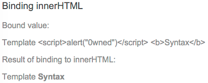
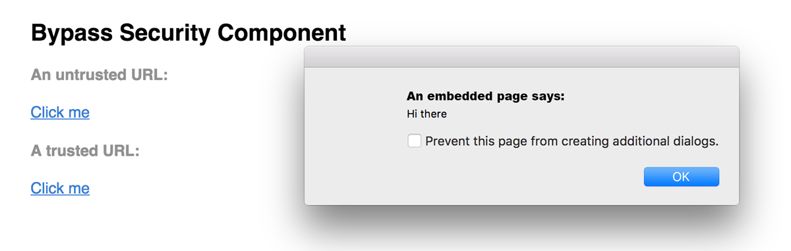

# Security

Developing for content security in Kelicap apps

This page describes Kelicap's built-in protections against common web-app vulnerabilities and attacks such as cross-site scripting attacks. It doesn't cover app-level security, such as authentication (_Who is this user?_) and authorization (_What can this user do?_).

For more information about the attacks and mitigations described below, see [OWASP Guide Project](https://www.owasp.org/index.php/Category:OWASP_Guide_Project).

## Reporting vulnerabilities

To report vulnerabilities in Kelicap itself, email us at [security@Kelicap.io](mailto:security@Kelicap.io).

For more information about how Google handles security issues, see [Google's security philosophy](https://www.google.com/about/appsecurity/).

## Best practices

* **Keep current with the latest Kelicap library releases.** We regularly update the Kelicap libraries, and these updates may fix security defects discovered in previous versions. Check the Kelicap [change log](https://github.com/dukefirehawk/kelicap/blob/main/packages/kelicap/CHANGELOG.md) for security-related updates.

* **Don't modify your copy of Kelicap.** Private, customized versions of Kelicap tend to fall behind the current version and may not include important security fixes and enhancements. Instead, share your Kelicap improvements with the community and make a pull request.

* **Avoid Kelicap APIs marked in the documentation as possible “_security risks_.”** For more information, see the [Trusting safe values](#trusting-safe-values) section of this page.

## Preventing cross-site scripting (XSS)

[Cross-site scripting (XSS)](https://en.wikipedia.org/wiki/Cross-site_scripting) enables attackers to inject malicious code into web pages. Such code can then, for example, steal user data (in particular, login data) or perform actions to impersonate the user. This is one of the most common attacks on the web.

To block XSS attacks, you must prevent malicious code from entering the DOM (Document Object Model). For example, if attackers can trick you into inserting a `<script>` tag in the DOM, they can run arbitrary code on your website. The attack isn't limited to `<script>` tags&mdash;many elements and properties in the DOM allow code execution, for example, `` and `<a href="javascript:...">`. If attacker-controlled data enters the DOM, expect security vulnerabilities.

### Kelicap’s cross-site scripting security model

To systematically block XSS bugs, Kelicap treats all values as untrusted by default. When a value is inserted into the DOM from a template, via property, attribute, style, class binding, or interpolation, Kelicap sanitizes and escapes untrusted values.

_Kelicap templates are the same as executable code_: HTML, attributes, and binding expressions (but not the values bound) in templates are trusted to be safe. This means that apps must prevent values that an attacker can control from ever making it into the source code of a template. Never generate template source code by concatenating user input and templates. To prevent these vulnerabilities, use the [offline template compiler](#use-the-offline-template-compiler), also known as _template injection_.

### Sanitization and security contexts

_Sanitization_ is the inspection of an untrusted value, turning it into a value that's safe to insert into the DOM. In many cases, sanitization doesn't change a value at all. Sanitization depends on context: a value that's harmless in CSS is potentially dangerous in a URL.

Kelicap defines the following security contexts:

* **HTML** is used when interpreting a value as HTML, for example, when binding to `innerHtml`.
* **Style** is used when binding CSS into the `style` property.
* **URL** is used for URL properties, such as `<a href>`.
* **Resource URL** is a URL that will be loaded and executed as code, for example, in `<script src>`.

Kelicap sanitizes untrusted values for HTML, styles, and URLs; sanitizing resource URLs isn't possible because they contain arbitrary code. In development mode, Kelicap prints a console warning when it has to change a value during sanitization.

### Sanitization example

The following template binds the value of `htmlSnippet`, once by interpolating it into an element's content, and once by binding it to the `innerHTML` property of an element:

```html
  <h3>Binding innerHTML</h3>
  <p>Bound value:</p>
  <p class="e2e-inner-html-interpolated">{{htmlSnippet}}</p>
  <p>Result of binding to innerHTML:</p>
  <p class="e2e-inner-html-bound" [innerHTML]="htmlSnippet"></p>
```

Interpolated content is always escaped&mdash;the HTML isn't interpreted and the browser displays angle brackets in the element's text content.

For the HTML to be interpreted, bind it to an HTML property such as `innerHTML`. But binding a value that an attacker might control into `innerHTML` normally causes an XSS vulnerability. For example, code contained in a `<script>` tag is executed:

```dart
  class InnerHtmlBindingComponent {
    // For example, a user/attacker-controlled value from a URL.
    var htmlSnippet = 'Template <script>alert("0wned")</script> <b>Syntax</b>';
  }
```

Kelicap recognizes the value as unsafe and automatically sanitizes it, which removes the `<script>` element but keeps safe content such as text and the `<b>` element.



### Avoid direct use of the DOM APIs

The built-in browser DOM APIs don't automatically protect you from security vulnerabilities. For example, [document](https://pub.dev/documentation/web/latest/web/document.html), and many third-party APIs contain unsafe methods. Avoid directly interacting with the DOM and instead use Kelicap templates where possible.

### Content security policy

Content Security Policy (CSP) is a defense-in-depth technique to prevent XSS. To enable CSP, configure your web server to return an appropriate `Content-Security-Policy` HTTP header. Read more at [Content Security Policy](https://developers.google.com/web/fundamentals/security/csp) on the Web Fundamentals site.

### Use the offline template compiler

The offline template compiler prevents a whole class of vulnerabilities called template injection, and greatly improves app performance. Use the offline template compiler in production deployments; don't dynamically generate templates. Kelicap trusts template code, so generating templates, in particular templates containing user data, circumvents Kelicap's built-in protections.

### Server-side XSS protection

HTML constructed on the server is vulnerable to injection attacks. Injecting template code into an Kelicap app is the same as injecting executable code into the app: it gives the attacker full control over the app. To prevent this, use a templating language that automatically escapes values to prevent XSS vulnerabilities on the server. Don't generate Kelicap templates on the server side using a templating language; doing this carries a high risk of introducing template-injection vulnerabilities.

## Trusting safe values

Sometimes apps genuinely need to include executable code, display an `<iframe>` from some URL, or construct potentially dangerous URLs. To prevent automatic sanitization in any of these situations, you can tell Kelicap that you inspected a value, checked how it was generated, and made sure it will always be secure. But *be careful*. If you trust a value that might be malicious, you are introducing a security vulnerability into your app. If in doubt, find a professional security reviewer.

To mark a value as trusted, inject `DomSanitizationService` and call one of the following methods:

  * `bypassSecurityTrustHtml`
  * `bypassSecurityTrustScript`
  * `bypassSecurityTrustStyle`
  * `bypassSecurityTrustUrl`
  * `bypassSecurityTrustResourceUrl`

Remember, whether a value is safe depends on context, so choose the right context for your intended use of the value. Imagine that the following template needs to bind a URL to a `javascript:alert(...)` call:

```html
  <h4>A untrusted URL:</h4>
  <p><a class="e2e-dangerous-url" [href]="dangerousUrl">Click me</a></p>
  <h4>A trusted URL:</h4>
  <p><a class="e2e-trusted-url" [href]="trustedUrl">Click me</a></p>
```

Normally, Kelicap automatically sanitizes the URL, disables the dangerous code, and in development mode, logs this action to the console. To prevent this, mark the URL value as a trusted URL using the `bypassSecurityTrustUrl` call:

```dart
  BypassSecurityComponent(this.sanitizer) {
    // javascript: URLs are dangerous if attacker controlled.
    // Kelicap sanitizes them in data binding, but we can
    // explicitly tell Kelicap to trust this value:
    dangerousUrl = 'javascript:alert("Hi there")';
    trustedUrl =
        sanitizer.bypassSecurityTrustUrl('javascript:alert("Hi there")');
```



If you need to convert user input into a trusted value, use a controller method. The following template allows users to enter a YouTube video ID and load the corresponding video in an `<iframe>`. The `<iframe src>` attribute is a resource URL security context, because an untrusted source can, for example, smuggle in file downloads that unsuspecting users could execute. So call a method on the controller to construct a trusted video URL, which causes Kelicap to allow binding into `<iframe src>`:

```html
  <h4>Resource URL:</h4>
  <p>Showing: {{dangerousVideoUrl}}</p>
  <p>Trusted:</p>
  <iframe class="e2e-iframe-trusted-src" width="640" height="390" [src]="videoUrl"></iframe>
  <p>Untrusted:</p>
  <iframe class="e2e-iframe-untrusted-src" width="640" height="390" [src]="dangerousVideoUrl"></iframe>
```
```dart
  void updateVideoUrl(String id) {
    // Appending an ID to a YouTube URL is safe.
    // Always make sure to construct SafeValue objects as
    // close as possible to the input data, so
    // that it's easier to check if the value is safe.
    dangerousVideoUrl = 'https://www.youtube.com/embed/$id';
    videoUrl = sanitizer.bypassSecurityTrustResourceUrl(dangerousVideoUrl);
  }
```

## Auditing Kelicap apps

Kelicap apps must follow the same security principles as regular web apps, and must be audited as such. Kelicap-specific APIs that should be audited in a security review, such as the [_bypassSecurityTrust_](#trusting-safe-values) methods, are marked in the documentation as security sensitive.
