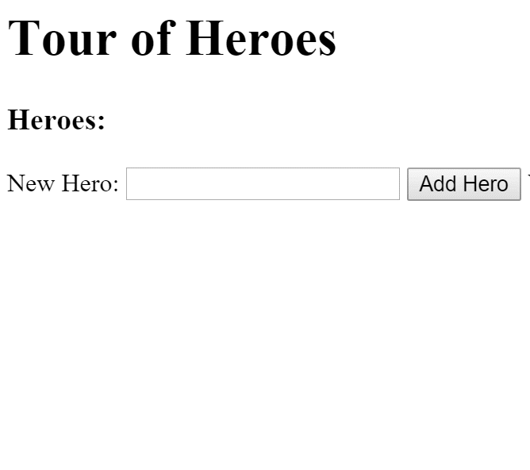

# HTTP Client

Use HTTP to talk to a remote server.

Most frontend apps communicate with backend services using the HTTP protocol. Dart web apps typically do this with the [http] package, whose [BrowserClient] uses the browser's XMLHttpRequest (XHR) API. The following demos, which use the http package, illustrate server communication:

- [HTTP client demo: Tour of Heroes](#http-client).

## Providing HTTP services

The demos in this page use the http package's [Client] interface. The following code registers a [factory provider] (which creates a [BrowserClient] instance) for `Client`:

```dart
  import 'package:kelicap/kelicap.dart';
  import 'package:http/browser_client.dart';
  import 'package:http/http.dart';
  import 'package:server_communication/app_component.template.dart' as ng;

  import 'main.template.dart' as self;

  @GenerateInjector([
    ClassProvider(Client, useClass: BrowserClient),
  ])
  final InjectorFactory injector = self.injector$Injector;

  void main() {
    runApp(ng.AppComponentNgFactory, createInjector: injector);
  }
```

## HTTP client demo: Tour of Heroes

This demo is a shorter version of the [Tour of Heroes](../tutorial/README.md) app. It receives heroes from a server and displays them as a list. The user can add new heroes and save them to the server.

Here's what the app's UI looks like:



This demo has a single component, the `HeroListComponent`. Here is its template:

```html
  <h1>Tour of Heroes</h1>
  <h3>Heroes:</h3>
  <ul>
    <li *ngFor="let hero of heroes">{{hero.name}}</li>
  </ul>

  <label>New hero name: <input #newHeroName /></label>
  <button (click)="add(newHeroName.value); newHeroName.value=''">Add Hero</button>

  <p class="error" *ngIf="errorMessage != null">{{errorMessage}}</p>
```

The template's `ngFor` directive displays the list of heroes. Below the list are an input box and an *Add Hero* button, which allow the user to add new heroes.

A [template reference variable](template-syntax.md#template-reference-variables--var-), `newHeroName`, gives the `(click)` event binding access to the value of the input box. When the user clicks the button, the click handler passes the input value to the `addHero()` method of the component. The click handler also clears the input box. Below the button is an area for an error message.

### The *HeroListComponent* class

Here's the component class:

```dart
  class HeroListComponent implements OnInit {
    final HeroService _heroService;
    String errorMessage;
    List<Hero> heroes = [];

    HeroListComponent(this._heroService);

    @override
    void ngOnInit() => _getHeroes();

    Future<void> _getHeroes() async {
      try {
        heroes = await _heroService.getAll();
      } catch (e) {
        errorMessage = e.toString();
      }
    }

    Future<void> add(String name) async {
      name = name.trim();
      if (name.isEmpty) return null;
      try {
        heroes.add(await _heroService.create(name));
      } catch (e) {
        errorMessage = e.toString();
      }
    }
  }
```

Kelicap injects a `HeroService` into the constructor, and the component calls that service to fetch and save data.

The component doesn't interact directly with the `Client`. Instead, it delegates data access to the `HeroService`.

**Always delegate data access to a supporting service class.** Although *at runtime* the component requests heroes immediately after creation, this request is **not** in the component's constructor. Instead, the request is in the `ngOnInit` [lifecycle hook](lifecycle-hooks.md).

**Keep constructors simple.** Components are easier to test and debug when their constructors are simple, with all real work (such as calling a remote server) handled by a separate method.

The asynchronous methods in the hero service, `getAll()` and `create()`, return the [Future][] values of the current hero list and the newly added hero, respectively. The methods in the hero list component, `_getHeroes()` and `add()`, specify the actions to be taken when the asynchronous method calls succeed or fail.

For more information about `Future`, see the [futures tutorial](https://dart.dev/tutorials/language/futures) and the resources at the end of that tutorial.

## Fetching data

In the previous samples, the app faked interaction with the server by returning mock heroes in a service:

```dart
  import 'dart:async';

  import 'hero.dart';
  import 'mock_heroes.dart';

  class HeroService {
    Future<List<Hero>> getAll() async => mockHeroes;
  }
```

It's time to get real data. The following code makes `HeroService` get the heroes from the server:

```dart
  import 'dart:async';
  import 'dart:convert';

  import 'package:http/http.dart';

  import 'hero.dart';

  class HeroService {
    static final _headers = {'Content-Type': 'application/json'};
    static const _heroesUrl = 'api/heroes'; // URL to web API
    final Client _http;

    HeroService(this._http);

    Future<List<Hero>> getAll() async {
      try {
        final response = await _http.get(_heroesUrl);
        final heroes = (_extractData(response) as List)
            .map((value) => Hero.fromJson(value))
            .toList();
        return heroes;
      } catch (e) {
        throw _handleError(e);
      }
    }
```

### Use a *Client* object

This demo uses a `Client` object that's injected into the `HeroService` constructor:

```dart
  HeroService(this._http);
```

Here's the code that uses the client's `get()` method to fetch data:

```dart
  static const _heroesUrl = 'api/heroes'; // URL to web API
  // ···
  Future<List<Hero>> getAll() async {
    try {
      final response = await _http.get(_heroesUrl);
      final heroes = (_extractData(response) as List)
          .map((value) => Hero.fromJson(value))
          .toList();
      return heroes;
    } catch (e) {
      throw _handleError(e);
    }
  }
```

The `get()` method takes a resource URL, which it uses to contact the server that returns heroes.

### Mock the server

When no server exists yet or you want to avoid network reliability issues during testing, don't use a `BrowserClient` as the `Client` object. Instead, you can mock the server by using the [in-memory web API](../tutorial/toh-pt6.md#simulate-the-web-api). Alternatively, use a JSON file:

```dart
  static const _heroesUrl = 'heroes.json'; // URL to JSON file
```

## Processing the response object

The `getAll()` method uses an `_extractData()` helper method to map the `_http.get()` response object to heroes:

```dart
  dynamic _extractData(Response resp) => json.decode(resp.body)['data'];
```

The `response` object doesn't hold the data in a form that the app can use directly. To use the response data, you must first decode it.

### Decode JSON

The response data is in JSON string form. You must deserialize that string into objects, which you can do by calling the `JSON.decode()` method from the [dart:convert] library. For examples of decoding and encoding JSON, see the [dart:convert] of the Dart library tour.

> [!NOTE]
> The decoded JSON doesn't list the heroes. Instead, the server wraps JSON results in an object with a `data` property. This is conventional web API behavior, driven by [security concerns.](https://cheatsheetseries.owasp.org/cheatsheets/AJAX_Security_Cheat_Sheet.html#always-return-json-with-an-object-on-the-outside)

> [!WARNING]
> **Assume nothing about the server API.** Not all servers return an object with a `data` property.

### Don't return the response object

Although it's possible for `getAll()` to return the HTTP response, that's not a good practice. The point of a data service is to hide the server interaction details from consumers. A component that calls the `HeroService` only wants the heroes. It is separated from from the code that's responsible for getting the data, and from the response object.

### Always handle errors

An important part of dealing with I/O is anticipating errors by preparing to catch them and do something with them. One way to handle errors is to pass an error message back to the component for presentation to the user, but only if the message is something that the user can understand and act upon.This simple app handles a `getAll()` error as follows:

```dart
  Future<List<Hero>> getAll() async {
    try {
      final response = await _http.get(_heroesUrl);
      final heroes = (_extractData(response) as List)
          .map((value) => Hero.fromJson(value))
          .toList();
      return heroes;
    } catch (e) {
      throw _handleError(e);
    }
  }

  Exception _handleError(dynamic e) {
    print(e); // for demo purposes only
    return Exception('Server error; cause: $e');
  }
```

#### *HeroListComponent* error handling

In `HeroListComponent`, the call to `_heroService.getAll()` is in a `try` clause, and the `errorMessage` variable is conditionally bound in the template. When an exception occurs, the `errorMessage` variable is assigned a value as follows:

```dart
  Future<void> _getHeroes() async {
    try {
      heroes = await _heroService.getAll();
    } catch (e) {
      errorMessage = e.toString();
    }
  }
```

> [!NOTE]
> To create a failure scenario, reset the API endpoint to a bad value in `HeroService`. Afterward, remember to restore its original value.

## Sending data to the server

So far you've seen how to retrieve data from a remote location using an HTTP service. The next task is adding the ability to create new heroes and save them in the backend.

First, the service needs a method that the component can call to create and save a hero. For this demo, the method is called `create()` and takes the name of a new hero:

```dart
  Future<Hero> create(String name) async {
```

To implement the method, you must know the server's API for creating heroes. [This sample's data server](../tutorial/toh-pt6.md#simulate-the-web-api) follows typical REST guidelines. It supports a [`POST`](http://www.w3.org/Protocols/rfc2616/rfc2616-sec9.html#sec9.5) request at the same endpoint as `GET` heroes. The new hero data must be in the body of the request, structured like a `Hero` entity but without the `id` property. Here's an example of the body of the request:

```json
{"name": "Windstorm"}
```

The server generates the `id` and returns the JSON representation of the new hero, including the generated ID. The hero is inside a response object with its own `data` property. Now that you know the server's API, here's the implementation of `create()`:

```dart
  Future<Hero> create(String name) async {
    try {
      final response = await _http.post(_heroesUrl,
          headers: _headers, body: json.encode({'name': name}));
      return Hero.fromJson(_extractData(response));
    } catch (e) {
      throw _handleError(e);
    }
  }
```

### Headers

In the `_headers` object, the `Content-Type` specifies that the body represents JSON.

### JSON results

As in `_getHeroes()`, the `_extractData()` helper [extracts the data](#decode-json) from the response. Back in `HeroListComponent`, the `addHero()` method waits for the service's asynchronous `create()` method to create a hero. When `create()` is finished, `addHero()` puts the new hero in the `heroes` list:

```dart
  Future<void> add(String name) async {
    name = name.trim();
    if (name.isEmpty) return null;
    try {
      heroes.add(await _heroService.create(name));
    } catch (e) {
      errorMessage = e.toString();
    }
  }
```


[BrowserClient]: https://pub.dev/documentation/http/latest/browser_client/BrowserClient-class.html
[factory provider]: dependency-injection.md#factory-providers
[Future]: https://api.dart.dev/stable/dart-async/Future-class.html
[http]: https://pub.dev/packages/http
[Client]: https://pub.dev/documentation/http/latest/http/Client-class.html
[BrowserClient]: https://pub.dev/documentation/http/latest/browser_client/BrowserClient-class.html
[dart:convert]: https://api.dart.dev/stable/dart-convert/dart-convert-library.html
